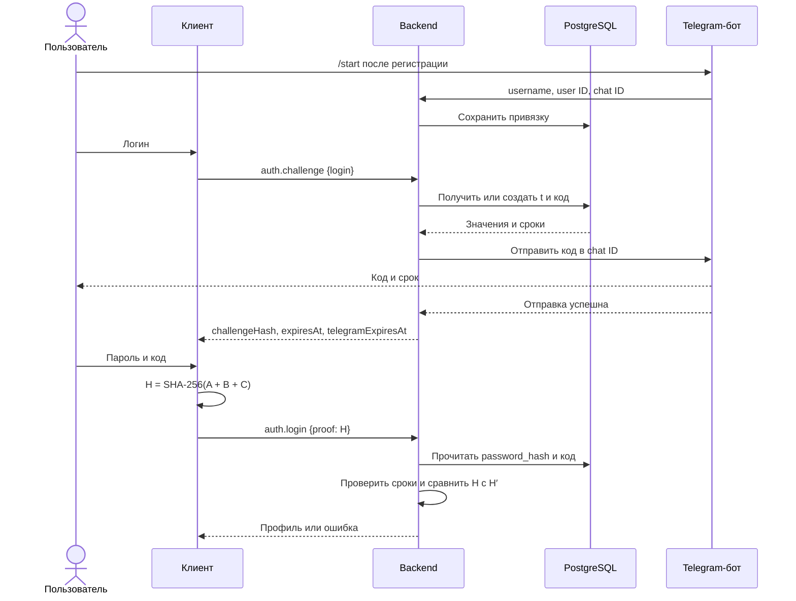

# Полный цикл аутентификации · лабораторная №3

Настройка бота и запуск описаны в [README](README.md), структура проекта — в [ARCHITECTURE](ARCHITECTURE.md).

Описанный ниже сценарий с кодом действует при `TELEGRAM_AUTH_ENABLED=true` (по умолчанию). Для работы без Telegram задайте `TELEGRAM_AUTH_ENABLED=false` в `.env` и перезапустите backend. Сервер не запрашивает привязку или код, не запускает бота и возвращает в challenge `telegramRequired: false`, `telegramExpiresAt: null`. Клиент показывает только пароль и вычисляет `H = SHA-256(SHA-256(пароль) + challengeHash)`. Сервер проверяет ту же формулу и срок t; неверный пароль по-прежнему отклоняется. Режим задаётся только на сервере, автоматического отключения при ошибках Telegram нет. При включённой проверке challenge содержит `telegramRequired: true` и срок кода.

## 1. Регистрация и Telegram

Администратор создаёт пользователя: логин, пароль, Telegram username и параметры RSA. В БД сохраняется `SHA-256(пароль)` от UTF-8; исходный пароль не сохраняется. RSA не участвует в формуле входа.

После регистрации пользователь отправляет `/start` боту из личного Telegram-аккаунта. Backend сопоставляет username без учёта регистра и начального `@`, сохраняет Telegram user ID и chat ID. Повторная команда того же владельца допустима. Другой владелец не может заменить существующую привязку. Несколько учётных записей с одним username могут привязаться к одному чату.

Без username бот просит установить его; если учётная запись ещё не создана, нужно создать её и повторить `/start`. Групповые команды игнорируются. В серверном интерфейсе отображается статус привязки.

## 2. Запрос вызова

Клиент отправляет `auth.challenge` с `{login}`. Сервер сбрасывает прежнюю авторизацию и challenge этого WebSocket, находит пользователя и получает `t` из PostgreSQL.

`t` — 16 случайных байтов, сохраняемых в `auth_challenges` на 24 часа. Пока срок не истёк, используется прежнее значение, включая переподключения и перезапуск backend. При следующем запросе после истечения генерируется новое. SHA-256 вычисляется от исходных байтов `t`, а не от их hex-представления.

Отдельно сервер получает Telegram-код из `telegram_codes`: число от 100000 до 999999 со сроком 10 минут. Оно также сохраняется между перезапусками. Получение и обновление каждого значения выполняются в транзакции с блокировкой пользователя, поэтому параллельные запросы используют один действующий код.

## 3. Доставка

Бот отправляет код в сохранённый личный чат вместе с логином приложения и точным сроком действия. Отправка ограничена 10 секундами. Если Telegram недоступен или бот заблокирован, сервер отвечает `TELEGRAM_UNAVAILABLE`; новый challenge соединения не активируется. Сохранённый код можно отправить повторно до истечения его срока.

Только после успешной отправки сервер активирует challenge и возвращает:

```ts
{
  challengeHash: '...', // SHA-256(t), 64 lowercase hex
  expiresAt: '...', // ISO: срок t
  telegramExpiresAt: '...', // ISO: срок Telegram-кода
}
```

Код и его отдельный хеш в этот ответ и события журнала не входят. Клиент открывает поля пароля и кода, показывает срок и кнопку повторной отправки. Повторная отправка использует `auth.challenge` и не продлевает срок кода.

## 4. Вычисление ответа

Пользователь вводит пароль и шесть цифр из Telegram. Браузер вычисляет:

```text
A = SHA-256(пароль в UTF-8)
B = SHA-256(исходные байты t), полученный от сервера
C = SHA-256(шестизначная десятичная строка кода в UTF-8)
H = SHA-256(A + B + C)
```

Каждый внутренний хеш — 64 символа lowercase hex. `+` означает склеивание без разделителей; внешний SHA-256 получает UTF-8 строку длиной 192 символа. Пароль не нормализуется: пробелы и регистр значимы.

Клиент очищает пароль и код и отправляет только `auth.login` с `{proof: H}`. Сервер требует строку из 64 lowercase hex-символов. Старый формат с паролем и прежняя формула из двух хешей не подходят.

## 5. Проверка и сессия

Сервер проверяет challenge текущего соединения и оба срока, читает пользователя и код из БД, проверяет соответствие сохранённого кода выданному challenge. Вычисляет:

```text
H′ = SHA-256(password_hash + challengeHash + SHA-256(код из БД))
```

`password_hash` уже является SHA-256 пароля; повторно хешировать его не нужно. H и H′ сравниваются через `timingSafeEqual`. Сроки проверяются ещё раз после запросов БД. На границе `now >= expiresAt` значение недействительно.

Неверный пароль или код дают общую ошибку `INVALID_CREDENTIALS`. До истечения сроков можно повторить ввод. При успехе сервер сохраняет user ID в WebSocket-сессии, очищает challenge соединения и возвращает профиль. Для следующего входа нужен новый запрос `auth.challenge`.

| Событие                              | Результат                                                |
| ------------------------------------ | -------------------------------------------------------- |
| Повторный запрос в пределах 10 минут | Тот же код и прежний срок                                |
| Успешный вход                        | Код в БД остаётся действующим                            |
| Код истёк                            | Проверка отклоняется; следующий запрос создаёт новый код |
| Истёк t                              | Проверка отклоняется; следующий запрос создаёт новый t   |
| `auth.me`                            | Профиль авторизованного соединения                       |
| `auth.logout` или разрыв соединения  | Авторизация и challenge соединения очищаются             |
| Истечение кода или t после входа     | Уже авторизованная сессия продолжает работать            |

Одинаковые пароль, t и код дают одинаковый proof. Повторное использование до истечения срока предусмотрено лабораторной; proof не одноразовый.

## 6. Журналы и схема

Клиент видит SHA-256(t), H, этапы доставки и результат. Серверный интерфейс дополнительно видит t в hex и H′. Пароль, его отдельный хеш, код, отдельный хеш кода и токен бота не журналируются. Оба интерфейса хранят последние 500 записей в памяти страницы.


